# WiTV 使用手册

WiTV 是一款运行在 Android TV / 电视盒子上的 IPTV 直播播放器。频道来自你自己提供的 M3U 地址，
节目单来自 XMLTV，支持运营商组播（`udp://` / `rtp://`）与普通 HTTP 直播流。

界面支持简体中文与 English，提供「标准」与「电视台包装」两套主题（见[主题](#主题)、[语言](#语言-language)）。

本手册中的截图取自真实设备（Amlogic 盒子，Android 7，有线连接），默认是「标准」主题、中文界面。

---

## 一、首次使用：添加播放源

首次启动时没有任何频道，播放页会显示一个二维码和局域网管理地址：


频道地址不在电视上输入——用遥控器敲 URL 太痛苦。做法是用**手机或电脑**打开那个地址：

- 手机：直接扫屏幕上的二维码；
- 电脑：在浏览器里输入下方的地址，例如 `http://192.168.6.134:9979`。

> 地址里的 IP 是盒子自己的局域网地址，接网线和连 Wi-Fi 都能正确识别。
> 如果显示的是 `0.0.0.0`，说明盒子还没拿到 IP，检查网线或 Wi-Fi 后点「刷新」。
> 手机/电脑必须和盒子在同一个局域网里。

打开后是 Web 管理页：

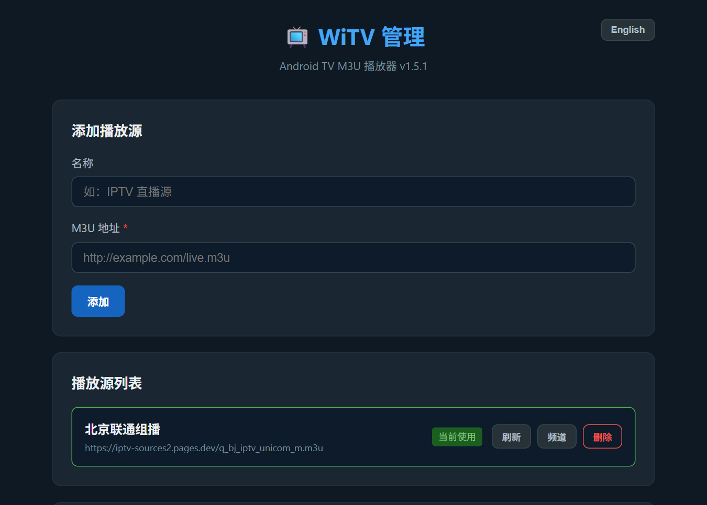

在「添加播放源」里填：

| 字段 | 说明 |
|------|------|
| 名称 | 随便起，用来区分多个订阅，例如「北京联通组播」。支持中文 |
| M3U 地址 | 直播源的 m3u / m3u8 地址，必填。也支持 `.m3u.gz` 压缩地址 |

点「添加」后会立即拉取并解析，解析完成就能在同一页看到频道列表与分组。

**电视这边不用再操作**：添加的是第一个播放源时，电视会自动加载频道并开始播放。
已经有别的播放源时，新加的不会自动顶替当前在用的那个——要看它，在播放源列表里点它旁边的「切换」，
或者在电视上 设置 → 地址管理 里选它。

> 电视上那个「重新加载频道」按钮是兜底用的：手机提示添加成功、电视却迟迟没反应时（比如盒子刚断过网），按它重新读一遍。

---

## 二、看电视

### 播放画面与信息

按**信息键**（或空格）显示/隐藏底部的节目与信号面板：


左下是当前频道、当前节目与下一档节目；右下是实际解出来的信号参数——分辨率、视频编码、
音频编码与声道数。排查「有画面没声音」「画面卡顿」时先看这里。

### 频道列表

按**确认键**打开频道列表：

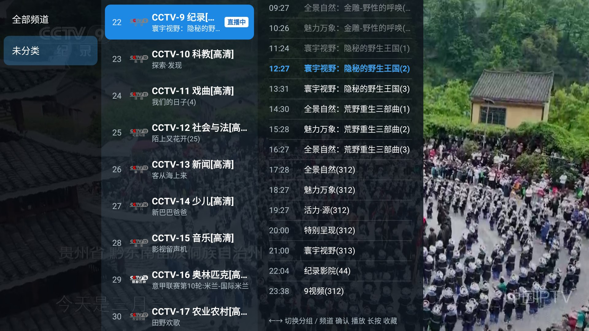

菜单分三栏，**左/右键**在栏之间移动：

- **分组**：「我的收藏」「全部频道」以及 M3U 里的各个分组；
- **频道**：每行左边是频道号（就是数字键换台用的那个号），下面一行是这个频道正在播出的节目，没有节目单时显示分组名；
- **节目单**：焦点所在频道当天的完整节目单，正在播出的那一档会标出来。这一栏只用来看，焦点不会停进去。

在频道栏按**确认键**播放，**长按确认键**收藏/取消收藏这一行。
返回键先从频道栏退回分组栏，再按一次关闭菜单。底部有一行按键提示，忘了可以看一眼。

### 换台的几种方式

| 操作 | 效果 |
|------|------|
| 上 / 下键 | 切换上一个 / 下一个频道（方向可在设置里反转） |
| 数字键 | 直接输入频道号跳转，例如按 `1` `5` 跳到 15 号 |
| 确认键 | 打开频道列表挑选 |
| 收藏键 / `F` | 收藏或取消收藏当前频道 |
| 点屏幕左半边 / 右半边 | 打开频道列表 / 打开设置（接了鼠标或触屏的设备） |

### 播不出来的时候

同一个频道在 M3U 里有多条地址时，一条卡住超过「超时换源」的时间（默认 15 秒）会自动换下一条。
全部试完还是不行，画面中间会出现「这个频道暂时播不了」，并给出三个按钮：

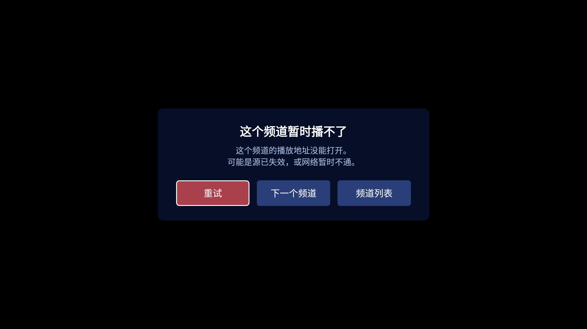

- **重试**：把这个频道重新起播一次，适合网络刚恢复的情况；
- **下一个频道**：直接换台；
- **频道列表**：打开频道列表自己挑。

源本身失效时重试也没用，只能换源或者到 Web 页面刷新订阅。

### 退出

在播放页按返回键会先确认一次，避免误触退出：

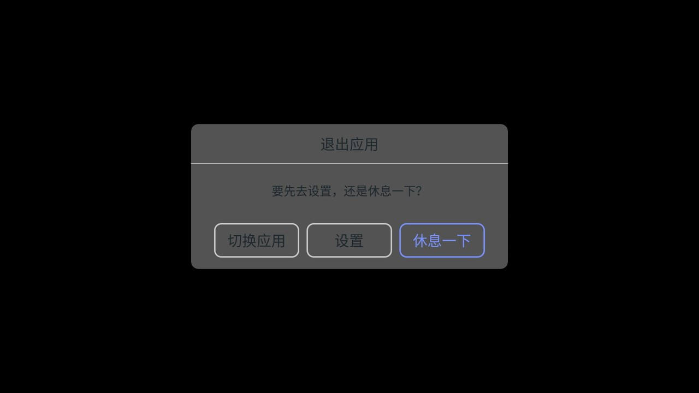

- **切换应用**：打开其他桌面或已安装的应用，见下文[作为桌面启动](#作为桌面启动)；
- **设置**：打开设置面板；
- **休息一下**：退出播放。WiTV 被设为默认桌面时不会真正退出（退出后系统会立刻把桌面拉起来），
  而是退到后台，回到上一个打开的应用。

---

## 三、设置

按**菜单键**（或 `F6`）打开设置，左右两栏：右侧是分类，选中后左侧展开该分类的内容。
返回键先收起当前分类，再按一次才关闭设置。

分类依次是：地址管理、切换源、超时换源、EPG、播放选项、组播 / UDP、解码方式、主题、语言 / Language、帮助与说明。

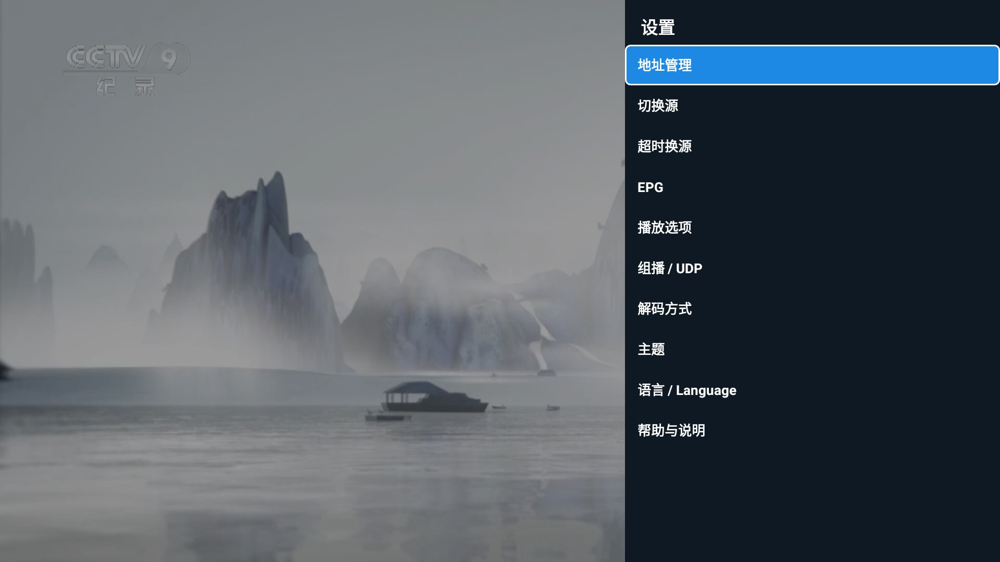

### 地址管理

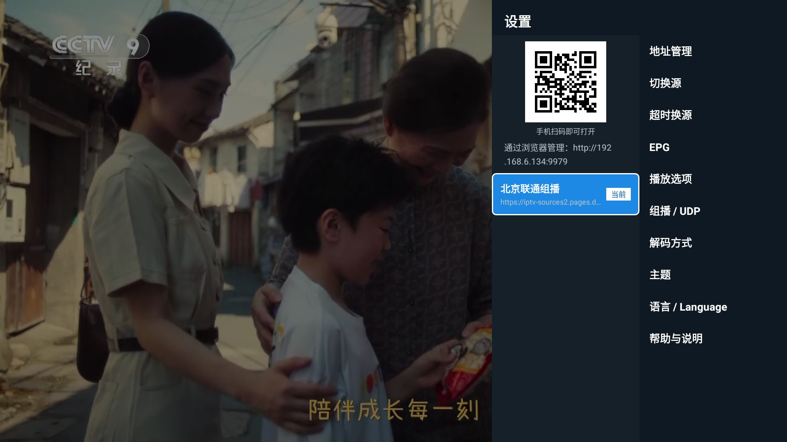

这里能看到管理地址的二维码、已添加的播放源和当前正在使用的那一个。
添加了多个播放源时，选中哪个就切到哪个；增删改仍然在 Web 页面上做。

### EPG（节目单）

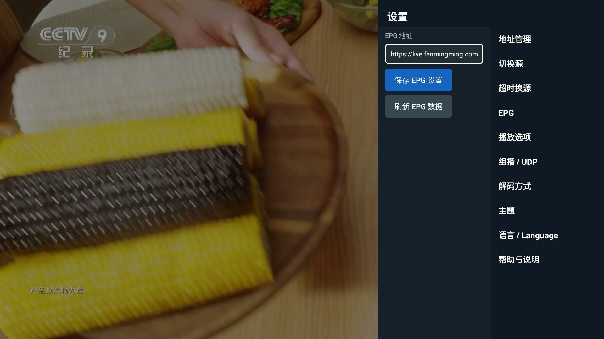

节目单是 XMLTV 格式，**支持 `.xml.gz` 压缩地址**（公开 EPG 源基本都是 gz，几十 MB 的节目单压缩后只有几 MB）。

每个播放源可以有两个 EPG 地址，各存各的：

- **直播源自带的**：M3U 头里的 `x-tvg-url`，每次刷新直播源时自动更新；
- **自定义的**：你自己填的地址，刷新直播源不会动它。

用哪一个由「使用自定义地址」开关决定，选中的那个是空的就自动用另一个。
开关在 [Web 管理页](#四web-管理页)上，那里两个地址都看得到，并标出「使用中」的是哪个。

电视上这一栏显示的是**当前生效**的地址。在这里修改并按「保存 EPG 设置」，
会存成自定义地址并切到它；清空后保存，则回到直播源自带的地址。
保存后按「刷新 EPG 数据」立即拉取。

平时不用手动刷新：加载直播源时，如果 EPG 地址变了或距上次成功拉取已满 1 小时，会在后台自动更新。

### 组播 / UDP

频道地址是 `udp://` 或 `rtp://` 时才用得上：

- **留空**：直接收组播。要求盒子所在的网络能收到运营商组播，**强烈建议走网线**——
  2.4G Wi-Fi 常常丢大包，表现为花屏和不断缓冲；
- **填 udpxy 地址**（如 `http://192.168.1.1:4022`）：组播改走 HTTP 单播，由路由器/软路由代理。
  适合盒子收不到组播、或只能用 Wi-Fi 的场景。

填好按「保存代理地址」。输入框下方会实时显示改写后的结果，确认无误再保存：


要改回直收组播，按「清除（直接收组播）」。

改写规则是把 `scheme://组播组:端口` 拼成 `代理前缀/scheme/组播组:端口`，例如

```
rtp://239.3.1.118:8001  →  http://192.168.6.1:5140/rtp/239.3.1.118:8001
```

地址前缀不用写 `/udp` 或 `/rtp`，也不用在意结尾的 `/`，保存时会统一规范化；
`http://` 省略也能识别。

> **保存后不会立刻切换**，提示是「下次换台生效」——当前这一路组播不中断，换台时才走新配置。

**不是只有 udpxy 能用。** 任何提供 udpxy 兼容路径的软件都行，例如 OpenWrt 上常见的
[rtp2httpd](https://github.com/stackia/rtp2httpd)，它同样接受 `/rtp/组:端口` 和 `/udp/组:端口`。

#### 代理和直收，选哪个

在 Amlogic 盒子（有线千兆）上实测同一路北京联通组播，两种方式各跑 60 秒：

| | 起播耗时 | 重缓冲 | 硬解器 `error_recovery` |
|---|---|---|---|
| 直收组播 | 2.1 s | 0 | 6 次 |
| 经 rtp2httpd 代理 | 2.3 s | 0 | 9 ~ 12 次 |

测试频道是 3840×2160 HDR / H.265 / 杜比数字 6 声道，实测码率约 40 Mbps；
1080p H.264 频道两种方式都是秒开。

结论是**有线环境下两者都够用**，代理那点差异在一分钟的样本里还算不上信号。
真正该用代理的是这两种情况：盒子所在网段收不到运营商组播，或者只能走 Wi-Fi。

### 解码方式

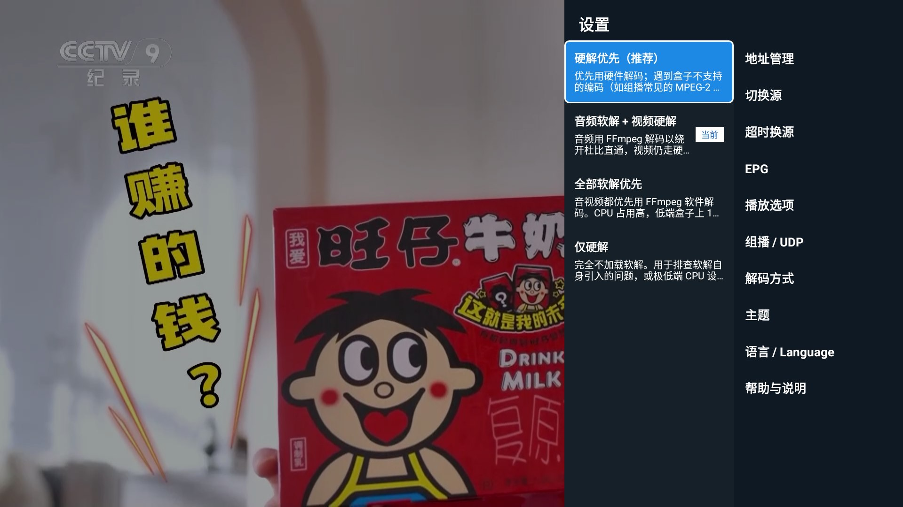

| 选项 | 什么时候用 |
|------|-----------|
| 硬解优先（推荐） | 默认。优先用盒子的硬件解码器 |
| 音频软解 + 视频硬解 | **杜比声道没声音时选这个**。音频交给 FFmpeg，绕开杜比直通；视频仍走硬解，不增加 CPU 负担 |
| 全部软解优先 | 音视频都用 FFmpeg。CPU 占用高，低端盒子上 1080p 以上会卡 |
| 仅硬解 | 完全不加载软解，用于排查软解自身引入的问题 |

切换后播放器会重建，画面会黑一下再恢复，属于正常现象。

### 播放选项

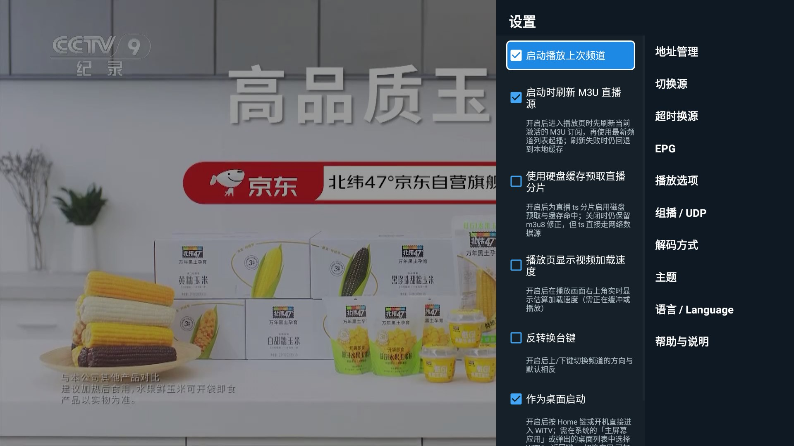

- **启动播放上次频道**：开机直接进上次看的台；
- **启动时刷新 M3U 直播源**：每次启动在后台刷新订阅。先用本地缓存的频道立即起播，刷新完成后静默换上新列表，
  正在看的节目不受影响；刷新失败（包括源站临时返回空列表）就继续用缓存。只有第一次使用、还没有缓存时才会等刷新结果；
- **使用硬盘缓存预取直播分片**：为 HLS 的 ts 分片启用磁盘预取与缓存命中；
- **播放页显示视频加载速度**：右上角实时显示估算速度，排查网络时有用；
- **反转换台键**：上/下键的换台方向与默认相反；
- **作为桌面启动**：让 WiTV 成为盒子的桌面，开机和按 Home 键直接看电视，详见下一节。

### 作为桌面启动

适合把盒子当成「开机就是电视」来用的家庭。默认关闭，不开启时 WiTV 不会出现在系统的桌面候选里，
按 Home 键也不会多出选择框。

**开启**

1. 设置 → 播放选项 → 勾选「作为桌面启动」；
2. WiTV 会打开系统的「默认应用」页面。点「主屏幕应用」（此时会显示「没有默认主屏幕」，属正常现象）：

   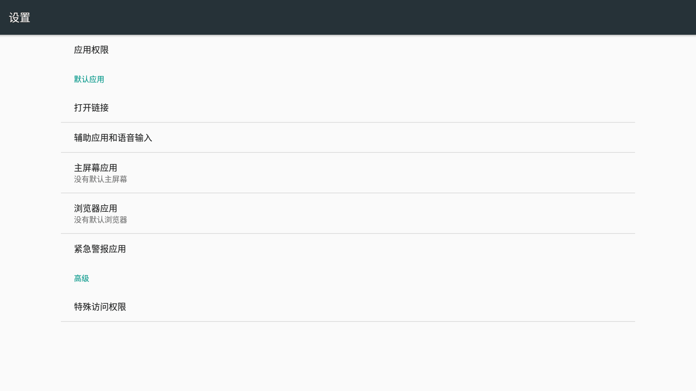

3. 在列表里选 **WiTV**：

   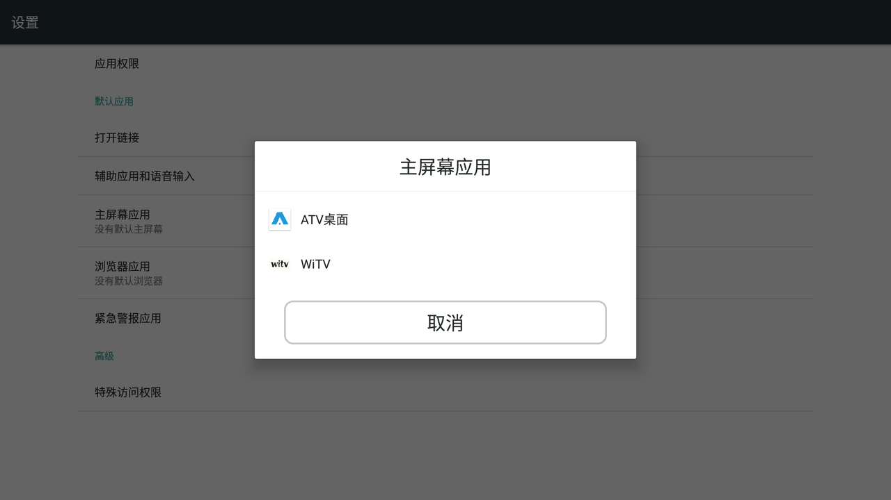

   没有「默认应用」页面的盒子会直接弹出桌面选择框，选 WiTV 并点「始终」即可。

之后开机会直接进入 WiTV 并播放上次看的频道，按 Home 键会回到正在播放的画面。
开机时网络往往比 WiTV 晚就绪一两秒，播放页会先提示「正在等待网络连接…」，连上后再起播；
有些盒子开机后系统的解码服务要过二三十秒才能用，这时会提示「正在等待系统解码服务…」，等它就绪后自动起播，不用手动换台。

**打开其他应用**

WiTV 当了桌面之后，其他应用从这里进：按返回键 → 「切换应用」。

<!-- 截图待核对：切换应用面板的布局还在改，定稿后重拍 -->
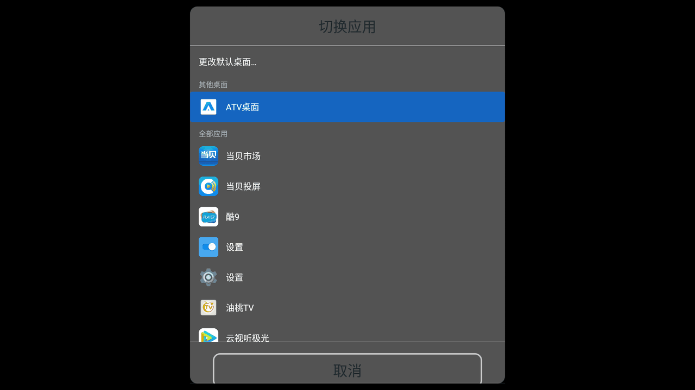

- **其他桌面**：原来的桌面（例如 ATV 桌面、当贝桌面）还在，可以随时临时打开，按 Home 键又会回到 WiTV；
- **全部应用**：盒子上所有可以启动的应用，包括系统设置；
- **更改默认桌面…**：重新打开系统的桌面选择，用来换回原来的桌面。

**换回原来的桌面**

两种方式任选：

- 切换应用 → 更改默认桌面… → 主屏幕应用 → 选原来的桌面；
- 或者直接在设置里取消勾选「作为桌面启动」，WiTV 退出桌面候选，按 Home 键就回到原来的桌面。

部分国产 ROM 锁定了默认桌面，选择框可能不出现，这种情况只能到盒子自带的系统设置里修改。

### 切换源 / 超时换源

同一个频道在 M3U 里可能有多条播放地址。「切换源」列出当前频道的所有线路（标着「当前」的是正在用的），
选哪条就换到哪条；频道只有一条地址时会提示「当前频道仅有一个播放地址」。

「超时换源」是一条线路卡住多久之后自动换下一条，可选 5 / 10 / 15 / 20 / 25 / 30 秒，默认 15 秒。
源多且常有失效的调短一些，换台更快；单源、或者 4K 这类起播本来就慢的频道，别调得太短，否则还没出画面就被当成失败。


### 主题

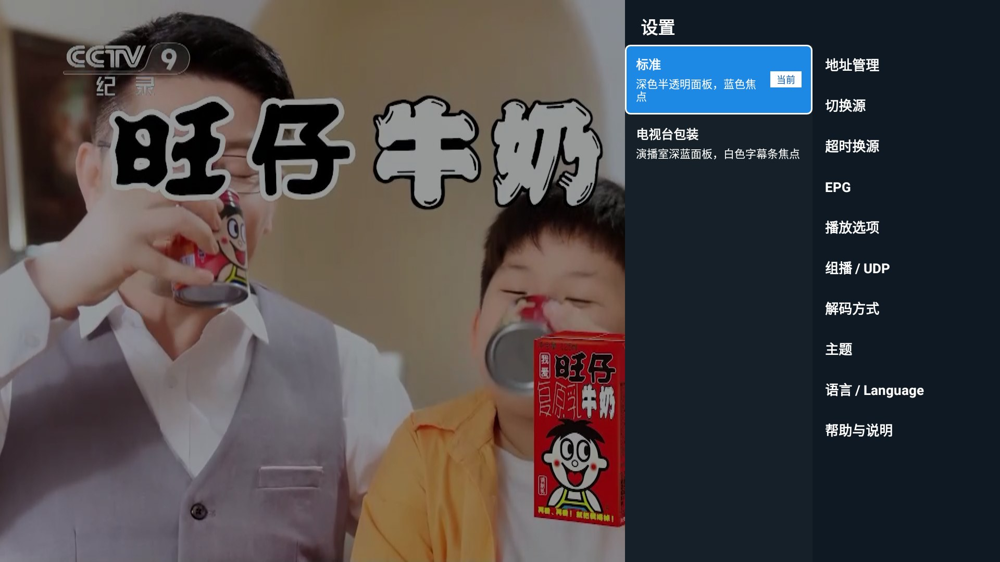

| 选项 | 样子 |
|------|------|
| 标准 | 默认。深色半透明面板，蓝色焦点（本手册的截图除特别注明外都是这套） |
| 电视台包装 | 演播室深蓝面板，频道列表的焦点是一条白色字幕条，正在播出的节目标黄色「正在播出」 |

同一个频道列表换成「电视台包装」是这样：

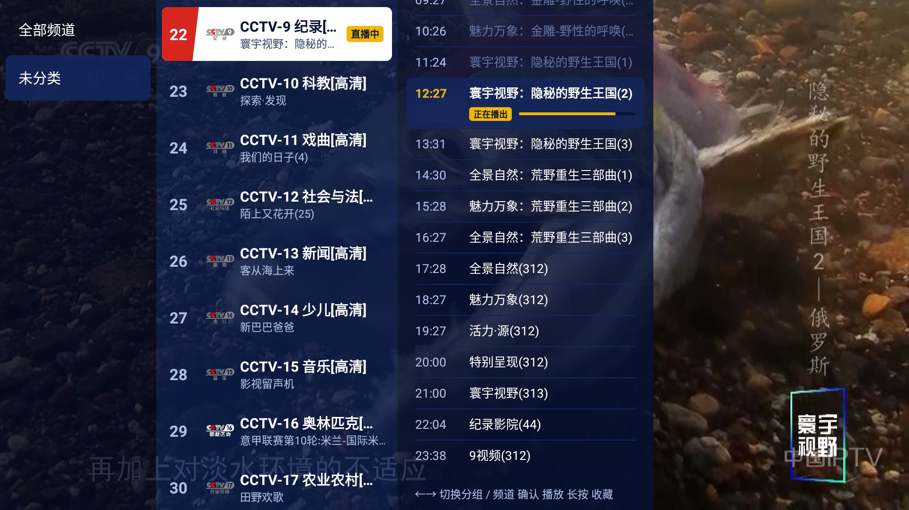

主题影响频道菜单、设置和各种面板。切换后界面会重建一次，当前频道重新起播。

### 语言 / Language


可选「跟随系统」（默认，用电视系统设置的语言）、「简体中文」、「English」。
语言名始终用各自的文字显示，切错了也认得出怎么切回来。和主题一样，切换后界面会重建一次。

Web 管理页的语言是单独的，用页面右上角的 English / 中文 按钮切换。

### 帮助与说明

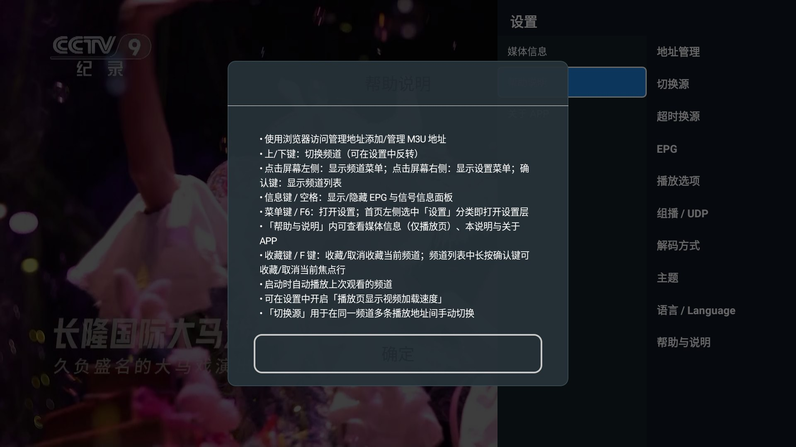

「媒体信息」显示当前播放的详细参数，「帮助说明」就是上图这份按键速查表，「关于 APP」显示版本号。

---

## 四、Web 管理页

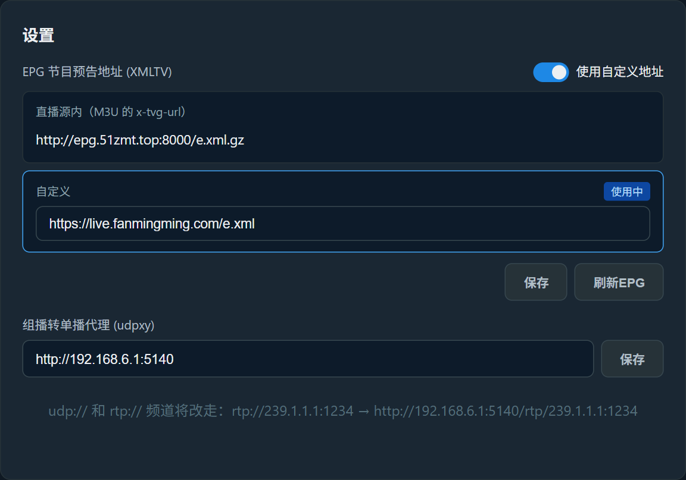

播放源列表里每个源旁边有四个按钮：

| 按钮 | 作用 |
|------|------|
| 切换 | 让电视改用这个源。同一时间只有一个源在用，标着「当前使用」 |
| 刷新 | 重新拉取这个订阅。拉到的是空列表或错误页时保留原有频道，不会被清空 |
| 频道 | 查看它解析出的频道与分组，点频道名可以看节目预告 |
| 删除 | 删掉这个源（会先确认一次） |

其他功能：

- 点频道旁边的星标**收藏**，收藏结果会同步到电视上的「我的收藏」分组；
- 页面底部的 **EPG**：上面一栏是直播源自带的地址（只读），下面一栏填自定义地址，
  「使用自定义地址」开关决定用哪个，正在生效的那个标着「使用中」。保存后会按新地址在后台刷新节目单；
- **组播转单播代理**：和电视上「组播 / UDP」里的是同一份设置，输入框下方同样会预览改写后的地址。

---

## 五、常见问题

**设成桌面后，开机显示「这个频道暂时播不了」**
等待网络和解码服务之后仍然失败，一般是源本身或网络有问题。点「重试」，或者「下一个频道」「频道列表」换个台，
见[播不出来的时候](#播不出来的时候)。

**管理地址显示 `0.0.0.0`**
盒子还没拿到局域网 IP。检查网线/Wi-Fi，确认路由器已分配地址，然后点「刷新」。

**手机打不开管理地址**
手机和盒子要在同一个局域网（同一个路由器，且没开 AP 隔离）。
端口是 `9979`，注意不要漏掉。

**杜比频道有画面没声音**
设置 →「解码方式」→ 选「音频软解 + 视频硬解」。

**组播频道花屏、一直缓冲**
优先改用网线。只能用 Wi-Fi 时，在路由器/软路由上装 udpxy 或 rtp2httpd，然后在「组播 / UDP」里填它的地址。

**节目单是空的**
先在 Web 管理页的 EPG 里看标着「使用中」的是哪个地址、它能不能访问；地址可以是 `.xml` 也可以是 `.xml.gz`。
电视上「刷新 EPG 数据」失败时会提示「EPG 刷新失败」和原因。
另外 M3U 里频道的 `tvg-name` / `tvg-id` 要和 EPG 里的频道名对得上，对不上就会显示「暂无节目信息」。

**列表名或频道名显示成乱码**
升级到 v1.3.0 及以上版本。

**界面变成了英文 / 想换成英文**
设置 →「语言 / Language」。选「跟随系统」时，电视系统语言是英文，WiTV 就是英文。

**改了自定义 EPG，刷新直播源后又变回去了**
升级到最新版即可：直播源自带的地址和自定义地址现在分开保存，刷新只更新前者。
如果节目单还是不对，检查「使用自定义地址」开关是否打开。
